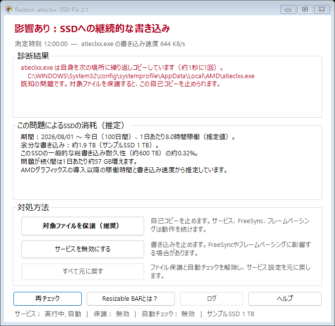
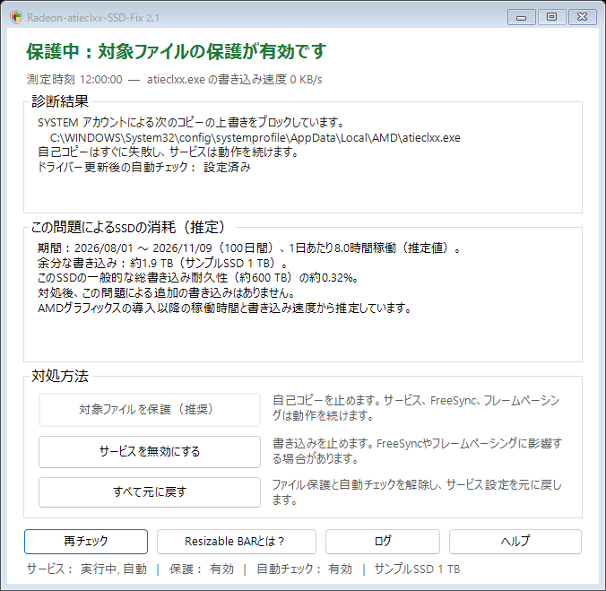

# Radeon-atieclxx-SSD-Fix

[日本語の使い方](HELP.ja.txt) · [English guide](HELP.en.txt) · [Deutsche Anleitung](LIESMICH.txt)

### Display language / 表示言語

Extract the entire ZIP and run `START.cmd`. The tool uses the Windows display language and falls back to English. Supported languages are German, English and Japanese. To override it for a PowerShell session, run `$env:RADEON_SSD_FIX_LANG = 'en'; .\START.cmd`.

ZIPをすべて展開し、`START.cmd` を起動するとWindowsの表示言語が使われる。日本語・英語・ドイツ語に対応し、それ以外は英語になる。日本語に固定して起動するには、展開先のPowerShellで `$env:RADEON_SSD_FIX_LANG = 'ja'; .\START.cmd` を実行する。

**Der Radeon-Treiber schreibt fortwährend auf deine SSD?** Bei betroffenen Treibern kopiert sich `atieclxx.exe` (Dienst „AMD External Events Utility“) jede Sekunde selbst – rund 56 GB pro Tag. Dieses Programm prüft, ob dein PC betroffen ist, schätzt den bisherigen Schaden und stoppt das Dauerschreiben gezielt, ohne den Dienst abzuschalten.

> **Hinweis:** Inoffizieller Workaround, nicht von AMD und ohne Verbindung zu AMD. Nutzung auf eigene Verantwortung, ohne Gewährleistung und ohne Haftung (siehe [LICENSE.txt](LICENSE.txt)).



*診断で影響を検出した画面（サンプル値） · [English screenshot](docs/screenshot-affected-en.png) · [Deutscher Screenshot](docs/screenshot-betroffen.png)*

## Das Problem

ComputerBase berichtete am 09.11.2026, dass der Dienst „AMD External Events Utility“ des Radeon-Treibers bei vielen Nutzern fortwährend auf das Systemlaufwerk schreibt ([Artikel](https://www.computerbase.de/news/grafikkarten/schnelle-ssd-alterung-radeon-treiber-schreibt-fortwaehrend-daten-auf-die-ssd.100237/)). AMD hat den Fehler bestätigt, eine korrigierte Treiberversion gibt es noch nicht.

Mit der Windows-Ereignisablaufverfolgung (ETW) nachgemessen: Bei betroffenen Treibern kopiert sich `atieclxx.exe` **jede Sekunde selbst** aus dem Treiberordner nach

```
C:\Windows\System32\config\systemprofile\AppData\Local\AMD\atieclxx.exe
```

Die Datei ist rund 660 KB groß, das sind im Dauerbetrieb etwa 56 GB pro Tag. Danach sucht der Dienst nach Installationsdateien des Filtertreibers `amdkmpfd` (Smart Access Memory). Das erklärt, warum manchen das Abschalten von Resizable BAR hilft.

## Download und Start

1. Unter [**Releases**](../../releases/latest) die Datei `Radeon-atieclxx-SSD-Fix.zip` herunterladen.
2. Die ZIP-Datei vollständig entpacken.
3. `START.cmd` doppelklicken und die Windows-Abfrage nach Administratorrechten mit „Ja“ bestätigen.

Falls Windows warnt („Der Computer wurde durch Windows geschützt“): „Weitere Informationen“ → „Trotzdem ausführen“. Oder vor dem Entpacken die ZIP-Datei mit Rechtsklick → Eigenschaften → „Zulassen“ freigeben.

## Was das Programm macht

- **Analyse:** misst, ob und wie stark `atieclxx.exe` schreibt, und zeigt, welche Variante vorliegt: Selbstkopie an die bekannte Stelle, Schreiben an einer anderen Stelle oder nicht betroffen.
- **Schadensschätzung:** wie viel bereits unnötig auf die SSD geschrieben wurde (Schreibrate × Betriebszeit seit der Installation der AMD-Grafik) und welcher Anteil der üblichen Schreib-Garantie das ist.
- **Fix-Knöpfe:**

| Knopf | Wirkung |
|---|---|
| **Gezielter Schutz** (empfohlen) | Verbietet nur dem Konto SYSTEM, diese eine Kopie zu überschreiben. Der Kopierversuch scheitert sofort, es wird nichts mehr geschrieben. Dienst, FreeSync, Frame Pacing und Hotkeys bleiben unberührt. Richtet zusätzlich eine Automatik ein (siehe unten). |
| **Dienst deaktivieren** | Die Variante aus dem Artikel. Wirkt immer, kann aber FreeSync und Frame Pacing beeinträchtigen. |
| **Alles rückgängig** | Nimmt Schutz, Automatik und Dienst-Deaktivierung zurück. |

Die dritte Möglichkeit aus dem Artikel, Resizable BAR im BIOS abzuschalten, erklärt das Programm. Umsetzen lässt sie sich nur im BIOS.



*対象ファイルを保護した後の画面（サンプル値） · [English screenshot](docs/screenshot-protected-en.png) · [Deutscher Screenshot](docs/screenshot-geschuetzt.png)*

### Automatik nach Treiber-Updates

Der gezielte Schutz richtet die Aufgabe „Radeon-atieclxx-SSD-Fix“ in der Aufgabenplanung ein. Sie läuft als SYSTEM 3 Minuten nach dem Start und danach alle 30 Minuten und

- setzt den Schutz neu, wenn ein Treiber-Update die Datei ersetzt hat,
- prüft nach einem Treiberwechsel selbst, ob AMD den Fehler behoben hat, und hebt den Schutz dann von allein auf,
- schreibt nur bei Ereignissen ins Protokoll `C:\Program Files\Radeon-atieclxx-SSD-Fix\protokoll.txt`.

## Technische Details

- Schutz: `icacls <Kopie> /deny *S-1-5-18:(WD,AD,WEA,WA,DE)`, also ein Verweigern-Eintrag nur für das Konto SYSTEM auf genau diese eine Datei.
- Die Selbstkopie wird über die USN des NTFS-Änderungsjournals erkannt (`FSCTL_READ_FILE_USN_DATA`). Zeitstempel taugen dafür nicht, weil `CopyFile` sie von der Quelle übernimmt. Als Rückfallebene ermittelt eine kurze ETW-Aufzeichnung (höchstens 64 MB, wird sofort gelöscht), wohin geschrieben wird.
- Die Messung läuft im Hintergrund, das Fenster bleibt bedienbar.
- Keine Downloads, keine Internetverbindung, keine Änderung am Treiber, keine AMD-Dateien im Paket. Der gesamte Quelltext liegt im Ordner [`Skript`](Skript).

## Status prüfen und entfernen

| Datei | Zweck |
|---|---|
| `PRUEFEN.cmd` | Status und 10-Sekunden-Messung, ohne Adminrechte |
| `ENTFERNEN.cmd` | nimmt alles zurück und löscht den Programmordner |

Nach dem gezielten Schutz liegen beide auch in `C:\Program Files\Radeon-atieclxx-SSD-Fix`.

## Alternative ohne dieses Programm

`Win+R` → `services.msc` → „AMD External Events Utility“ → Beenden, Starttyp „Deaktiviert“. Das ist der Vorschlag aus dem Artikel; er kann FreeSync und Frame Pacing beeinträchtigen.

## Grenzen

- Andere Treiberversionen können sich anders verhalten. Das Programm misst deshalb vorher und greift nur ein, wenn der Fix wirkt.
- Die Schadensschätzung ist eine Schätzung. Viele SSDs geben ihre Betriebsstunden nicht an Windows weiter, dann wird mit 8 Stunden pro Tag gerechnet.
- Auf PCs, auf denen per Firmenrichtlinie nur signierte PowerShell-Skripte erlaubt sind, startet das Programm nicht.
- Unter Windows Home gibt es keine Hinweisfenster der Automatik (`msg.exe` fehlt dort). Alles steht trotzdem im Protokoll.

## Lizenz und Marken

MIT-Lizenz, siehe [LICENSE.txt](LICENSE.txt). AMD, Radeon und Smart Access Memory sind Marken der Advanced Micro Devices, Inc. Dieses Projekt steht in keiner Verbindung zu AMD und wird von AMD weder unterstützt noch geprüft.

---

## English summary

Unofficial workaround for an AMD Radeon driver bug reported on 2026-11-09: the "AMD External Events Utility" (`atieclxx.exe`) copies itself every second to `C:\Windows\System32\config\systemprofile\AppData\Local\AMD\atieclxx.exe` (about 660 KB/s, roughly 56 GB per day of continuous SSD writes). This tool measures whether a PC is affected, estimates the writes so far and offers fixes: a targeted file-permission block (deny write/delete for SYSTEM on that single file, so the service, FreeSync and frame pacing keep working) with a scheduled task that keeps it in place after driver updates and lifts it automatically once AMD ships a fix, disabling the service, or reverting everything. German user interface. No downloads, no network access, no driver modification. MIT licensed, not affiliated with AMD.
